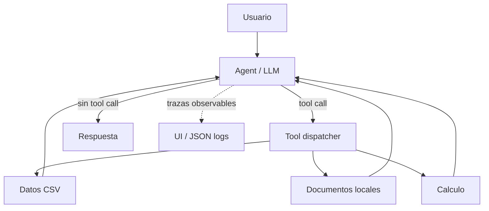

# Arquitectura del laboratorio

Principio didactico: el modelo decide **que herramienta necesita**; las herramientas realizan operaciones verificables. La interfaz muestra acciones observables, no razonamiento privado del modelo.
